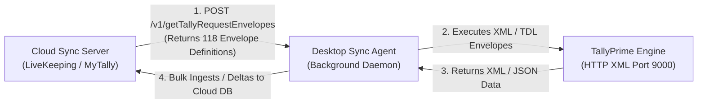
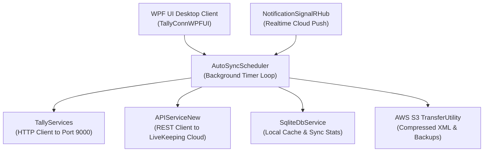
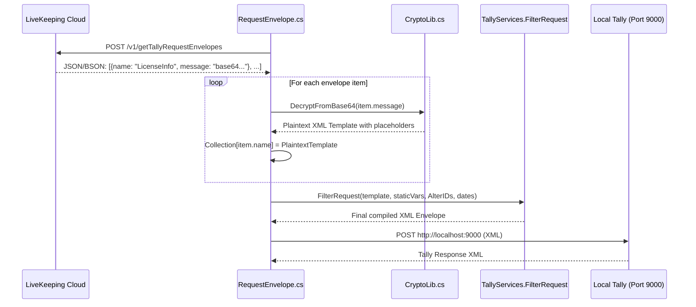

# Tally Request Envelopes & TDL Extraction Reference

> **Origin & Context:** Derived from the LiveKeeping desktop sync API discovery (`POST /v1/getTallyRequestEnvelopes`), reverse-engineering 118 real-world Tally synchronization envelopes, and cross-referenced with native TallyPrime TDL (Tally Definition Language) and XML HTTP interfaces (Port 9000).  
> **Target Audience:** MyTally Desktop Sync Agent engineers, backend architects, and Tally integration developers.

---

## 1. Executive Architecture Overview

Cloud-to-desktop synchronization systems (such as **LiveKeeping** and **MyTally**) run a local lightweight desktop client on the Windows machine hosting TallyPrime. Rather than writing hardcoded queries in the desktop client binary, modern sync systems use a **dynamic envelope orchestration architecture**:



### Key Architectural Characteristics
1. **Cloud-Driven Envelope Catalog**: The cloud server delivers the envelope instructions (`name` and TDL XML template) to the desktop agent.
2. **Selective Execution & Feature Gating**: In the API response, certain envelopes (such as `VouchersJobWorkOutOrder`, `VouchersAttendance`, `VouchersPayroll`, `VouchersJobWorkInOrder`) return an empty message string (`""`). This indicates feature gating (unlicensed modules) or fallback to standard native Tally collection exports.
3. **Dual Execution Mechanisms**:
   - **Type A — Dynamic On-The-Fly TDL Reports (`<TYPE>Data</TYPE>` with `<TDL>`)**: Compiles custom reports in Tally's memory grid to extract computed metrics, system variables (`$$ProductSerial`, `$$TSSExpiryDate`), and hierarchical calculations.
   - **Type B — Collection & Object Exports (`<TYPE>Collection</TYPE>` or `<TYPE>Object</TYPE>`)**: Directly extracts native database collections with selective method filtering (`<FETCH>` and `<COMPUTE>`) and AlterID watermark filters.

---

## 2. Complete Inventory of All 118 Sync Envelopes

The `getTallyRequestEnvelopes` endpoint exposes exactly **118 distinct synchronization envelopes**. Below is the complete catalog grouped into 12 functional domains:

| # | Domain | Envelopes Count | Envelope Names |
|---|---|:---:|---|
| 1 | **System & License Diagnostics** | 9 | `LicenseInfo`, `TallyInfo`, `TallyVersion`, `TallyFeatures`, `AccountingFeatures`, `InventoryFeatures`, `StatutoryFeatures`, `TallyTdlAddOns`, `MerchantProfile` |
| 2 | **Company & Multi-Tenant Discovery** | 5 | `Companies`, `AllCompanies`, `Company`, `CompanyGuid`, `CompanyDetails` |
| 3 | **Accounting Masters** | 7 | `Groups`, `Ledgers`, `Units`, `Currencies`, `PriceLevels`, `VoucherTypes`, `VchCreationConfig` |
| 4 | **Inventory Masters** | 4 | `StockGroups`, `StockCategories`, `StockItems`, `Godowns` |
| 5 | **Statutory & Tax Masters** | 4 | `GSTClassifications`, `GSTDetail`, `GSTRegistrations`, `TDSCategories` |
| 6 | **Cost Centre & Allocation Masters** | 3 | `CostCategories`, `CostCentres`, `CostCentresGuid` |
| 7 | **Financial & Business Reports** | 6 | `BalanceSheet`, `ProfitAndLoss`, `TrailBalance`, `RatioAnalysis`, `Statistics`, `ExceptionReport` |
| 8 | **Inventory & Stock Reports** | 9 | `StockSummary`, `StockSummaryByName`, `StockSummaryGuid`, `InventorySummary`, `InventorySummaryBySkName`, `InventorySummaryGuid`, `GodownSummary`, `StockItemLastSaleDate`, `StockItemLastPurchaseDate` |
| 9 | **Outstandings & Ledger Summaries** | 11 | `Outstandings`, `OutstandingsWithoutOnAccount`, `LedgersForOutstandings`, `GroupPaymentPerformance`, `GroupSummary`, `LedgerSummary`, `LedgerSummaryByName`, `LedgerSummaryGuid`, `LedgerGroupSummary`, `LedgerBalance`, `LedgerBalances` |
| 10 | **Sync Watermarks & AlterID Tracking** | 17 | `AlterIds`, `MasterGuids`, `MasterObjectCount`, `ObjectCount`, `AllMasterCount`, `VoucherAlterIds`, `VoucherAlterIdsVT`, `VoucherAlterIdsMismatch`, `VoucherAlterIdsMismatchByVT`, `VoucherStatistics`, `ReportVoucherGuids`, `ReportVoucherWithGstGuids`, `VoucherNumberSeries`, `VoucherNumberSeriesByVT`, `VoucherNumberByVT`, `VoucherNumberWithGstByVT`, `VoucherByVTAndVN` |
| 11 | **Core Voucher Pipelines** | 6 | `Vouchers`, `VouchersPartial`, `VouchersByVT`, `VouchersByAlterIdList`, `VouchersByAlterIdListVT`, `VouchersGstDetails` |
| 12 | **Specialized Voucher Types** | 24 | `VouchersSales`, `VouchersPurchase`, `VouchersReceipt`, `VouchersPayment`, `VouchersJournal`, `VouchersContra`, `VouchersCreditNote`, `VouchersDebitNote`, `VouchersSalesOrder`, `VouchersPurchaseOrder`, `VouchersDeliveryNote`, `VouchersReceiptNote`, `VouchersMaterialIn`, `VouchersMaterialOut`, `VouchersPhysicalStock`, `VouchersStockJournal`, `VouchersRejectionsIn`, `VouchersRejectionsOut`, `VouchersMemorandum`, `VouchersReversingJournal`, `VouchersAttendance`, `VouchersPayroll`, `VouchersJobWorkInOrder`, `VouchersJobWorkOutOrder` |
| 13 | **Voucher Print Configurations** | 13 | `VPrintConfigSales`, `VPrintConfigPurchase`, `VPrintConfigReceipt`, `VPrintConfigPayment`, `VPrintConfigJournal`, `VPrintConfigContra`, `VPrintConfigSalesOrder`, `VPrintConfigPurchaseOrder`, `VPrintConfigDeliveryNote`, `VPrintConfigReceiptNote`, `VPrintConfigPhysicalStock`, `VPrintConfigStockJournal`, `VPrintConfigOutstandings` |

---

## 3. Detailed TDL & XML Request Specs by Domain

All requests below target the local Tally instance running on port **9000** (or your designated port), using `POST` with `Content-Type: text/xml;charset=utf-8`.

---

### Domain 1: System & License Diagnostics

These envelopes capture license entitlement, versioning, product features, and environment configuration.

#### 1.1 `LicenseInfo` (Dynamic TDL Report Request)
Scrapes system formula variables directly from Tally memory:

```xml
<ENVELOPE>
  <HEADER>
    <VERSION>1</VERSION>
    <TALLYREQUEST>Export</TALLYREQUEST>
    <TYPE>Data</TYPE>
    <ID>License Info Request</ID>
  </HEADER>
  <BODY>
    <DESC>
      <STATICVARIABLES>
        <SVEXPORTFORMAT>$$SysName:XML</SVEXPORTFORMAT>
      </STATICVARIABLES>
      <TDL>
        <TDLMESSAGE>
          <REPORT NAME="SysLicenseReport">
            <FORMS>SysLicenseForm</FORMS>
          </REPORT>
          <FORM NAME="SysLicenseForm">
            <PARTS>SysLicensePart</PARTS>
          </FORM>
          <PART NAME="SysLicensePart">
            <LINES>SysLicenseLine</LINES>
          </PART>
          <LINE NAME="SysLicenseLine">
            <FIELDS>SysSerialNo, SysLicenseType, SysTSSExpiry, SysAccountID, SysAdminEmail</FIELDS>
          </LINE>
          <FIELD NAME="SysSerialNo">
            <SET>$$ProductSerial</SET>
          </FIELD>
          <FIELD NAME="SysLicenseType">
            <SET>if $$IsSilver then "Silver" else if $$IsGold then "Gold" else "Educational"</SET>
          </FIELD>
          <FIELD NAME="SysTSSExpiry">
            <SET>$$TSSExpiryDate</SET>
          </FIELD>
          <FIELD NAME="SysAccountID">
            <SET>$$AccountID</SET>
          </FIELD>
          <FIELD NAME="SysAdminEmail">
            <SET>$$AdminEmail</SET>
          </FIELD>
        </TDLMESSAGE>
      </TDL>
    </DESC>
  </BODY>
</ENVELOPE>
```

**cURL Execution:**
```bash
curl -X POST "http://localhost:9000" \
  -H "Content-Type: text/xml;charset=utf-8" \
  -d '<ENVELOPE><HEADER><VERSION>1</VERSION><TALLYREQUEST>Export</TALLYREQUEST><TYPE>Data</TYPE><ID>License Info Request</ID></HEADER><BODY><DESC><STATICVARIABLES><SVEXPORTFORMAT>$$SysName:XML</SVEXPORTFORMAT></STATICVARIABLES><TDL><TDLMESSAGE><REPORT NAME="SysLicenseReport"><FORMS>SysLicenseForm</FORMS></REPORT><FORM NAME="SysLicenseForm"><PARTS>SysLicensePart</PARTS></FORM><PART NAME="SysLicensePart"><LINES>SysLicenseLine</LINES></PART><LINE NAME="SysLicenseLine"><FIELDS>SysSerialNo,SysLicenseType,SysTSSExpiry,SysAccountID,SysAdminEmail</FIELDS></LINE><FIELD NAME="SysSerialNo"><SET>$$ProductSerial</SET></FIELD><FIELD NAME="SysLicenseType"><SET>if $$IsSilver then "Silver" else if $$IsGold then "Gold" else "Educational"</SET></FIELD><FIELD NAME="SysTSSExpiry"><SET>$$TSSExpiryDate</SET></FIELD><FIELD NAME="SysAccountID"><SET>$$AccountID</SET></FIELD><FIELD NAME="SysAdminEmail"><SET>$$AdminEmail</SET></FIELD></TDLMESSAGE></TDL></DESC></BODY></ENVELOPE>'
```

#### 1.2 `TallyInfo` & `TallyVersion` (Alternative "About Product" Native Report)
Extracts build number, release tag, data paths, and license data without dynamic compilation:

```xml
<ENVELOPE>
  <HEADER>
    <TALLYREQUEST>Export Data</TALLYREQUEST>
  </HEADER>
  <BODY>
    <EXPORTDATA>
      <REQUESTDESC>
        <REPORTNAME>About Product</REPORTNAME>
        <STATICVARIABLES>
          <SVEXPORTFORMAT>$$SysName:XML</SVEXPORTFORMAT>
        </STATICVARIABLES>
      </REQUESTDESC>
    </EXPORTDATA>
  </BODY>
</ENVELOPE>
```

**cURL Execution:**
```bash
curl -X POST "http://localhost:9000" \
  -H "Content-Type: text/xml;charset=utf-8" \
  -d '<ENVELOPE><HEADER><TALLYREQUEST>Export Data</TALLYREQUEST></HEADER><BODY><EXPORTDATA><REQUESTDESC><REPORTNAME>About Product</REPORTNAME><STATICVARIABLES><SVEXPORTFORMAT>$$SysName:XML</SVEXPORTFORMAT></STATICVARIABLES></REQUESTDESC></EXPORTDATA></BODY></ENVELOPE>'
```

#### 1.3 `AccountingFeatures`, `InventoryFeatures`, `StatutoryFeatures`
Discovers active feature flags on the current company (e.g. multi-currency, bill-wise details, batches, GST enabled):

```xml
<ENVELOPE>
  <HEADER>
    <VERSION>1</VERSION>
    <TALLYREQUEST>Export</TALLYREQUEST>
    <TYPE>Object</TYPE>
    <SUBTYPE>Company</SUBTYPE>
    <ID TYPE="Name">Bhrama Enterprises</ID>
  </HEADER>
  <BODY>
    <DESC>
      <STATICVARIABLES>
        <SVEXPORTFORMAT>$$SysName:XML</SVEXPORTFORMAT>
        <SVCURRENTCOMPANY>Bhrama Enterprises</SVCURRENTCOMPANY>
      </STATICVARIABLES>
      <FETCHLIST>
        <FETCH>IsBillWiseOn</FETCH>
        <FETCH>IsCostCentresOn</FETCH>
        <FETCH>IsMultiCurrencyOn</FETCH>
        <FETCH>IsBatchEnabled</FETCH>
        <FETCH>IsGodownEnabled</FETCH>
        <FETCH>IsOrderEnabled</FETCH>
        <FETCH>IsGSTApplicable</FETCH>
        <FETCH>IsTCSApplicable</FETCH>
        <FETCH>IsTDSApplicable</FETCH>
      </FETCHLIST>
    </DESC>
  </BODY>
</ENVELOPE>
```

---

### Domain 2: Company & Multi-Company Discovery

Enables the sync agent to identify open companies, enumerate all companies on disk, and match companies by immutable GUID.

#### 2.1 `Companies` (Open Active Companies) & `CompanyGuid`
Queries the open company list and binds the GUID:

```xml
<ENVELOPE>
  <HEADER>
    <VERSION>1</VERSION>
    <TALLYREQUEST>Export</TALLYREQUEST>
    <TYPE>Collection</TYPE>
    <ID>OpenCompaniesCollection</ID>
  </HEADER>
  <BODY>
    <DESC>
      <STATICVARIABLES>
        <SVEXPORTFORMAT>$$SysName:XML</SVEXPORTFORMAT>
      </STATICVARIABLES>
      <TDL>
        <TDLMESSAGE>
          <COLLECTION NAME="OpenCompaniesCollection">
            <TYPE>Company</TYPE>
            <COMPUTE>Name : $Name</COMPUTE>
            <COMPUTE>Guid : $Guid</COMPUTE>
            <COMPUTE>StartingFrom : $StartingFrom</COMPUTE>
            <COMPUTE>BooksFrom : $BooksFrom</COMPUTE>
            <COMPUTE>CompanyNumber : $CompanyNumber</COMPUTE>
            <COMPUTE>DataPath : $$DataPath</COMPUTE>
          </COLLECTION>
        </TDLMESSAGE>
      </TDL>
    </DESC>
  </BODY>
</ENVELOPE>
```

**cURL Execution:**
```bash
curl -X POST "http://localhost:9000" \
  -H "Content-Type: text/xml;charset=utf-8" \
  -d '<ENVELOPE><HEADER><VERSION>1</VERSION><TALLYREQUEST>Export</TALLYREQUEST><TYPE>Collection</TYPE><ID>OpenCompaniesCollection</ID></HEADER><BODY><DESC><STATICVARIABLES><SVEXPORTFORMAT>$$SysName:XML</SVEXPORTFORMAT></STATICVARIABLES><TDL><TDLMESSAGE><COLLECTION NAME="OpenCompaniesCollection"><TYPE>Company</TYPE><COMPUTE>Name : $Name</COMPUTE><COMPUTE>Guid : $Guid</COMPUTE><COMPUTE>StartingFrom : $StartingFrom</COMPUTE><COMPUTE>BooksFrom : $BooksFrom</COMPUTE><COMPUTE>CompanyNumber : $CompanyNumber</COMPUTE><COMPUTE>DataPath : $$DataPath</COMPUTE></COLLECTION></TDLMESSAGE></TDL></DESC></BODY></ENVELOPE>'
```

#### 2.2 `AllCompanies` (All Companies in Data Directory)
Extracts the disk-level company directory list even if unopened:

```xml
<ENVELOPE>
  <HEADER>
    <VERSION>1</VERSION>
    <TALLYREQUEST>Export</TALLYREQUEST>
    <TYPE>Collection</TYPE>
    <ID>AllCompaniesCollection</ID>
  </HEADER>
  <BODY>
    <DESC>
      <STATICVARIABLES>
        <SVEXPORTFORMAT>$$SysName:XML</SVEXPORTFORMAT>
      </STATICVARIABLES>
      <TDL>
        <TDLMESSAGE>
          <COLLECTION NAME="AllCompaniesCollection">
            <TYPE>Company</TYPE>
            <NATIVE METHOD>Name, Guid, StartingFrom, BooksFrom, CompanyNumber</NATIVE METHOD>
          </COLLECTION>
        </TDLMESSAGE>
      </TDL>
    </DESC>
  </BODY>
</ENVELOPE>
```

---

### Domain 3: Master Data Ingestion (`Groups`, `Ledgers`, `StockItems`, `Units`, etc.)

Masters are synced incrementally by filtering on `$AlterID > [LastKnownWatermark]`.

#### 3.1 `Ledgers` (Incremental Fetch)
Fetches all ledger modifications since the last sync cursor:

```xml
<ENVELOPE>
  <HEADER>
    <VERSION>1</VERSION>
    <TALLYREQUEST>Export</TALLYREQUEST>
    <TYPE>Collection</TYPE>
    <ID>IncrementalLedgers</ID>
  </HEADER>
  <BODY>
    <DESC>
      <STATICVARIABLES>
        <SVEXPORTFORMAT>$$SysName:XML</SVEXPORTFORMAT>
        <SVCURRENTCOMPANY>Bhrama Enterprises</SVCURRENTCOMPANY>
      </STATICVARIABLES>
      <TDL>
        <TDLMESSAGE>
          <COLLECTION NAME="IncrementalLedgers">
            <TYPE>Ledger</TYPE>
            <FILTER>AlterIdFilter</FILTER>
            <FETCH>Name, Parent, OpeningBalance, ClosingBalance, PartyGSTIN, PriorStateName, PinCode, LedgerContact, LedgerMobile, Email, CreditDays, CreditLimit, AlterID, MasterID, GUID</FETCH>
          </COLLECTION>
          <SYSTEM TYPE="Formulae" NAME="AlterIdFilter">
            $AlterID > 1050
          </SYSTEM>
        </TDLMESSAGE>
      </TDL>
    </DESC>
  </BODY>
</ENVELOPE>
```

**cURL Execution:**
```bash
curl -X POST "http://localhost:9000" \
  -H "Content-Type: text/xml;charset=utf-8" \
  -d '<ENVELOPE><HEADER><VERSION>1</VERSION><TALLYREQUEST>Export</TALLYREQUEST><TYPE>Collection</TYPE><ID>IncrementalLedgers</ID></HEADER><BODY><DESC><STATICVARIABLES><SVEXPORTFORMAT>$$SysName:XML</SVEXPORTFORMAT><SVCURRENTCOMPANY>Bhrama Enterprises</SVCURRENTCOMPANY></STATICVARIABLES><TDL><TDLMESSAGE><COLLECTION NAME="IncrementalLedgers"><TYPE>Ledger</TYPE><FILTER>AlterIdFilter</FILTER><FETCH>Name,Parent,OpeningBalance,ClosingBalance,PartyGSTIN,PriorStateName,PinCode,LedgerContact,LedgerMobile,Email,CreditDays,CreditLimit,AlterID,MasterID,GUID</FETCH></COLLECTION><SYSTEM TYPE="Formulae" NAME="AlterIdFilter">$AlterID > 0</SYSTEM></TDLMESSAGE></TDL></DESC></BODY></ENVELOPE>'
```

#### 3.2 `StockItems` & `StockGroups`
Extracts items with unit mappings, GST rates, HSN codes, and opening/closing balances:

```xml
<ENVELOPE>
  <HEADER>
    <VERSION>1</VERSION>
    <TALLYREQUEST>Export</TALLYREQUEST>
    <TYPE>Collection</TYPE>
    <ID>IncrementalStockItems</ID>
  </HEADER>
  <BODY>
    <DESC>
      <STATICVARIABLES>
        <SVEXPORTFORMAT>$$SysName:XML</SVEXPORTFORMAT>
        <SVCURRENTCOMPANY>Bhrama Enterprises</SVCURRENTCOMPANY>
      </STATICVARIABLES>
      <TDL>
        <TDLMESSAGE>
          <COLLECTION NAME="IncrementalStockItems">
            <TYPE>StockItem</TYPE>
            <FILTER>AlterIdFilter</FILTER>
            <FETCH>Name, Parent, BaseUnits, OpeningBalance, OpeningValue, ClosingBalance, ClosingValue, StandardPrice, StandardCost, HSNCode, AlterID, MasterID, GUID</FETCH>
          </COLLECTION>
          <SYSTEM TYPE="Formulae" NAME="AlterIdFilter">
            $AlterID > 0
          </SYSTEM>
        </TDLMESSAGE>
      </TDL>
    </DESC>
  </BODY>
</ENVELOPE>
```

---

### Domain 4: Watermark & AlterID Tracking (Change Data Capture)

The AlterID engine is the backbone of high-speed sync. Instead of pulling 100,000 vouchers to check for updates, the sync agent queries AlterID maps.

#### 4.1 `AlterIds` & `MasterGuids`
Extracts a lightweight map of all Master IDs and their Alter IDs to detect deletes or modifications:

```xml
<ENVELOPE>
  <HEADER>
    <VERSION>1</VERSION>
    <TALLYREQUEST>Export</TALLYREQUEST>
    <TYPE>Collection</TYPE>
    <ID>MasterAlterIdCollection</ID>
  </HEADER>
  <BODY>
    <DESC>
      <STATICVARIABLES>
        <SVEXPORTFORMAT>$$SysName:XML</SVEXPORTFORMAT>
        <SVCURRENTCOMPANY>Bhrama Enterprises</SVCURRENTCOMPANY>
      </STATICVARIABLES>
      <TDL>
        <TDLMESSAGE>
          <COLLECTION NAME="MasterAlterIdCollection">
            <TYPE>Masters</TYPE>
            <COMPUTE>MasterID : $MasterID</COMPUTE>
            <COMPUTE>AlterID  : $AlterID</COMPUTE>
            <COMPUTE>GUID     : $GUID</COMPUTE>
            <COMPUTE>ObjType  : $$DeclType</COMPUTE>
          </COLLECTION>
        </TDLMESSAGE>
      </TDL>
    </DESC>
  </BODY>
</ENVELOPE>
```

#### 4.2 `VoucherAlterIds` & `VoucherAlterIdsVT`
Extracts voucher Alter IDs partitioned by Voucher Type (`$VoucherTypeName`) to pinpoint altered transactions:

```xml
<ENVELOPE>
  <HEADER>
    <VERSION>1</VERSION>
    <TALLYREQUEST>Export</TALLYREQUEST>
    <TYPE>Collection</TYPE>
    <ID>VoucherAlterIdsCollection</ID>
  </HEADER>
  <BODY>
    <DESC>
      <STATICVARIABLES>
        <SVEXPORTFORMAT>$$SysName:XML</SVEXPORTFORMAT>
        <SVCURRENTCOMPANY>Bhrama Enterprises</SVCURRENTCOMPANY>
      </STATICVARIABLES>
      <TDL>
        <TDLMESSAGE>
          <COLLECTION NAME="VoucherAlterIdsCollection">
            <TYPE>Voucher</TYPE>
            <COMPUTE>MasterID : $MasterID</COMPUTE>
            <COMPUTE>AlterID  : $AlterID</COMPUTE>
            <COMPUTE>VchNo    : $VoucherNumber</COMPUTE>
            <COMPUTE>VchType  : $VoucherTypeName</COMPUTE>
            <COMPUTE>Date     : $Date</COMPUTE>
            <COMPUTE>GUID     : $GUID</COMPUTE>
          </COLLECTION>
        </TDLMESSAGE>
      </TDL>
    </DESC>
  </BODY>
</ENVELOPE>
```

**cURL Execution:**
```bash
curl -X POST "http://localhost:9000" \
  -H "Content-Type: text/xml;charset=utf-8" \
  -d '<ENVELOPE><HEADER><VERSION>1</VERSION><TALLYREQUEST>Export</TALLYREQUEST><TYPE>Collection</TYPE><ID>VoucherAlterIdsCollection</ID></HEADER><BODY><DESC><STATICVARIABLES><SVEXPORTFORMAT>$$SysName:XML</SVEXPORTFORMAT><SVCURRENTCOMPANY>Bhrama Enterprises</SVCURRENTCOMPANY></STATICVARIABLES><TDL><TDLMESSAGE><COLLECTION NAME="VoucherAlterIdsCollection"><TYPE>Voucher</TYPE><COMPUTE>MasterID : $MasterID</COMPUTE><COMPUTE>AlterID  : $AlterID</COMPUTE><COMPUTE>VchNo : $VoucherNumber</COMPUTE><COMPUTE>VchType : $VoucherTypeName</COMPUTE><COMPUTE>Date : $Date</COMPUTE><COMPUTE>GUID : $GUID</COMPUTE></COLLECTION></TDLMESSAGE></TDL></DESC></BODY></ENVELOPE>'
```

#### 4.3 `VoucherStatistics` & `Statistics`
Fetches count totals per voucher type for cross-checking sync parity:

```xml
<ENVELOPE>
  <HEADER>
    <TALLYREQUEST>Export Data</TALLYREQUEST>
  </HEADER>
  <BODY>
    <EXPORTDATA>
      <REQUESTDESC>
        <REPORTNAME>Statistics</REPORTNAME>
        <STATICVARIABLES>
          <SVEXPORTFORMAT>$$SysName:XML</SVEXPORTFORMAT>
          <SVCURRENTCOMPANY>Bhrama Enterprises</SVCURRENTCOMPANY>
        </STATICVARIABLES>
      </REQUESTDESC>
    </EXPORTDATA>
  </BODY>
</ENVELOPE>
```

---

### Domain 5: Financial & Business Analytics Reports

Direct extraction of Tally's financial reporting surfaces using native static variables.

#### 5.1 `ProfitAndLoss`
Extracts P&L for a period with complete schedule breakdowns:

```xml
<ENVELOPE>
  <HEADER>
    <TALLYREQUEST>Export Data</TALLYREQUEST>
  </HEADER>
  <BODY>
    <EXPORTDATA>
      <REQUESTDESC>
        <REPORTNAME>Profit and Loss</REPORTNAME>
        <STATICVARIABLES>
          <SVEXPORTFORMAT>$$SysName:XML</SVEXPORTFORMAT>
          <SVCURRENTCOMPANY>Bhrama Enterprises</SVCURRENTCOMPANY>
          <SVFROMDATE>20240401</SVFROMDATE>
          <SVTODATE>20250331</SVTODATE>
          <EXPLODEALLLLEVELS>Yes</EXPLODEALLLLEVELS>
        </STATICVARIABLES>
      </REQUESTDESC>
    </EXPORTDATA>
  </BODY>
</ENVELOPE>
```

**cURL Execution:**
```bash
curl -X POST "http://localhost:9000" \
  -H "Content-Type: text/xml;charset=utf-8" \
  -d '<ENVELOPE><HEADER><TALLYREQUEST>Export Data</TALLYREQUEST></HEADER><BODY><EXPORTDATA><REQUESTDESC><REPORTNAME>Profit and Loss</REPORTNAME><STATICVARIABLES><SVEXPORTFORMAT>$$SysName:XML</SVEXPORTFORMAT><SVCURRENTCOMPANY>Bhrama Enterprises</SVCURRENTCOMPANY><SVFROMDATE>20240401</SVFROMDATE><SVTODATE>20250331</SVTODATE><EXPLODEALLLLEVELS>Yes</EXPLODEALLLLEVELS></STATICVARIABLES></REQUESTDESC></EXPORTDATA></BODY></ENVELOPE>'
```

#### 5.2 `BalanceSheet`
Extracts Liabilities, Capital, and Assets hierarchy:

```xml
<ENVELOPE>
  <HEADER>
    <TALLYREQUEST>Export Data</TALLYREQUEST>
  </HEADER>
  <BODY>
    <EXPORTDATA>
      <REQUESTDESC>
        <REPORTNAME>Balance Sheet</REPORTNAME>
        <STATICVARIABLES>
          <SVEXPORTFORMAT>$$SysName:XML</SVEXPORTFORMAT>
          <SVCURRENTCOMPANY>Bhrama Enterprises</SVCURRENTCOMPANY>
          <SVFROMDATE>20240401</SVFROMDATE>
          <SVTODATE>20250331</SVTODATE>
          <EXPLODEALLLLEVELS>Yes</EXPLODEALLLLEVELS>
        </STATICVARIABLES>
      </REQUESTDESC>
    </EXPORTDATA>
  </BODY>
</ENVELOPE>
```

#### 5.3 `TrailBalance` (Trial Balance)
Extracts ledger-level debit and credit balances:

```xml
<ENVELOPE>
  <HEADER>
    <TALLYREQUEST>Export Data</TALLYREQUEST>
  </HEADER>
  <BODY>
    <EXPORTDATA>
      <REQUESTDESC>
        <REPORTNAME>Trial Balance</REPORTNAME>
        <STATICVARIABLES>
          <SVEXPORTFORMAT>$$SysName:XML</SVEXPORTFORMAT>
          <SVCURRENTCOMPANY>Bhrama Enterprises</SVCURRENTCOMPANY>
          <SVFROMDATE>20240401</SVFROMDATE>
          <SVTODATE>20250331</SVTODATE>
          <ISLEDGERWISE>Yes</ISLEDGERWISE>
          <EXPLODEALLLLEVELS>Yes</EXPLODEALLLLEVELS>
        </STATICVARIABLES>
      </REQUESTDESC>
    </EXPORTDATA>
  </BODY>
</ENVELOPE>
```

---

### Domain 6: Outstandings & Ledger Summaries

Powers receivable/payable aging, party statement cards, and payment performance.

#### 6.1 `Outstandings` & `LedgersForOutstandings`
Extracts pending bills and overdue days across Sundry Debtors & Creditors:

```xml
<ENVELOPE>
  <HEADER>
    <VERSION>1</VERSION>
    <TALLYREQUEST>Export</TALLYREQUEST>
    <TYPE>Collection</TYPE>
    <ID>BillsOutstandingCollection</ID>
  </HEADER>
  <BODY>
    <DESC>
      <STATICVARIABLES>
        <SVEXPORTFORMAT>$$SysName:XML</SVEXPORTFORMAT>
        <SVCURRENTCOMPANY>Bhrama Enterprises</SVCURRENTCOMPANY>
      </STATICVARIABLES>
      <TDL>
        <TDLMESSAGE>
          <COLLECTION NAME="BillsOutstandingCollection">
            <TYPE>Bills</TYPE>
            <FETCH>BillDate, BillName, Parent, OpeningBalance, ClosingBalance, BillCreditPeriod, OverdueDays</FETCH>
          </COLLECTION>
        </TDLMESSAGE>
      </TDL>
    </DESC>
  </BODY>
</ENVELOPE>
```

**cURL Execution:**
```bash
curl -X POST "http://localhost:9000" \
  -H "Content-Type: text/xml;charset=utf-8" \
  -d '<ENVELOPE><HEADER><VERSION>1</VERSION><TALLYREQUEST>Export</TALLYREQUEST><TYPE>Collection</TYPE><ID>BillsOutstandingCollection</ID></HEADER><BODY><DESC><STATICVARIABLES><SVEXPORTFORMAT>$$SysName:XML</SVEXPORTFORMAT><SVCURRENTCOMPANY>Bhrama Enterprises</SVCURRENTCOMPANY></STATICVARIABLES><TDL><TDLMESSAGE><COLLECTION NAME="BillsOutstandingCollection"><TYPE>Bills</TYPE><FETCH>BillDate,BillName,Parent,OpeningBalance,ClosingBalance,BillCreditPeriod,OverdueDays</FETCH></COLLECTION></TDLMESSAGE></TDL></DESC></BODY></ENVELOPE>'
```

#### 6.2 `LedgerBalance` & `LedgerBalances`
Extracts party-wise debit/credit closing balances:

```xml
<ENVELOPE>
  <HEADER>
    <VERSION>1</VERSION>
    <TALLYREQUEST>Export</TALLYREQUEST>
    <TYPE>Collection</TYPE>
    <ID>LedgerBalancesCollection</ID>
  </HEADER>
  <BODY>
    <DESC>
      <STATICVARIABLES>
        <SVEXPORTFORMAT>$$SysName:XML</SVEXPORTFORMAT>
        <SVCURRENTCOMPANY>Bhrama Enterprises</SVCURRENTCOMPANY>
      </STATICVARIABLES>
      <TDL>
        <TDLMESSAGE>
          <COLLECTION NAME="LedgerBalancesCollection">
            <TYPE>Ledger</TYPE>
            <COMPUTE>Name : $Name</COMPUTE>
            <COMPUTE>Parent : $Parent</COMPUTE>
            <COMPUTE>ClosingBalance : $ClosingBalance</COMPUTE>
            <COMPUTE>Guid : $GUID</COMPUTE>
          </COLLECTION>
        </TDLMESSAGE>
      </TDL>
    </DESC>
  </BODY>
</ENVELOPE>
```

---

### Domain 7: Inventory & Stock Reports

Powers stock summaries, godown valuation, and slow-moving/inactive stock detection.

#### 7.1 `StockSummary` & `StockSummaryGuid`
Extracts closing stock values and quantities for all stock items:

```xml
<ENVELOPE>
  <HEADER>
    <VERSION>1</VERSION>
    <TALLYREQUEST>Export</TALLYREQUEST>
    <TYPE>Collection</TYPE>
    <ID>StockSummaryCollection</ID>
  </HEADER>
  <BODY>
    <DESC>
      <STATICVARIABLES>
        <SVEXPORTFORMAT>$$SysName:XML</SVEXPORTFORMAT>
        <SVCURRENTCOMPANY>Bhrama Enterprises</SVCURRENTCOMPANY>
      </STATICVARIABLES>
      <TDL>
        <TDLMESSAGE>
          <COLLECTION NAME="StockSummaryCollection">
            <TYPE>StockItem</TYPE>
            <COMPUTE>Name : $Name</COMPUTE>
            <COMPUTE>BaseUnits : $BaseUnits</COMPUTE>
            <COMPUTE>ClosingBalance : $ClosingBalance</COMPUTE>
            <COMPUTE>ClosingRate : $ClosingRate</COMPUTE>
            <COMPUTE>ClosingValue : $ClosingValue</COMPUTE>
            <COMPUTE>Guid : $GUID</COMPUTE>
          </COLLECTION>
        </TDLMESSAGE>
      </TDL>
    </DESC>
  </BODY>
</ENVELOPE>
```

#### 7.2 `StockItemLastSaleDate` & `StockItemLastPurchaseDate`
Calculates last activity timestamps to identify inactive/dead stock:

```xml
<ENVELOPE>
  <HEADER>
    <VERSION>1</VERSION>
    <TALLYREQUEST>Export</TALLYREQUEST>
    <TYPE>Collection</TYPE>
    <ID>StockActivityCollection</ID>
  </HEADER>
  <BODY>
    <DESC>
      <STATICVARIABLES>
        <SVEXPORTFORMAT>$$SysName:XML</SVEXPORTFORMAT>
        <SVCURRENTCOMPANY>Bhrama Enterprises</SVCURRENTCOMPANY>
      </STATICVARIABLES>
      <TDL>
        <TDLMESSAGE>
          <COLLECTION NAME="StockActivityCollection">
            <TYPE>StockItem</TYPE>
            <COMPUTE>Name : $Name</COMPUTE>
            <COMPUTE>LastSaleDate : $LastSaleDate</COMPUTE>
            <COMPUTE>LastPurchaseDate : $LastPurchaseDate</COMPUTE>
          </COLLECTION>
        </TDLMESSAGE>
      </TDL>
    </DESC>
  </BODY>
</ENVELOPE>
```

---

### Domain 8: Specialized Voucher Ingestion (`VouchersSales`, `VouchersPurchase`, etc.)

Rather than requesting generic vouchers, LiveKeeping and high-throughput sync agents split requests into voucher type buckets for performance, crash avoidance, and parallel indexing.

#### 8.1 `VouchersSales` (With Inventory, Ledgers & GST Details)
Queries Sales vouchers altered after a specific watermark:

```xml
<ENVELOPE>
  <HEADER>
    <VERSION>1</VERSION>
    <TALLYREQUEST>Export</TALLYREQUEST>
    <TYPE>Collection</TYPE>
    <ID>SalesVouchersCollection</ID>
  </HEADER>
  <BODY>
    <DESC>
      <STATICVARIABLES>
        <SVEXPORTFORMAT>$$SysName:XML</SVEXPORTFORMAT>
        <SVCURRENTCOMPANY>Bhrama Enterprises</SVCURRENTCOMPANY>
      </STATICVARIABLES>
      <TDL>
        <TDLMESSAGE>
          <COLLECTION NAME="SalesVouchersCollection">
            <TYPE>Voucher</TYPE>
            <CHILD OF>$$VchTypeSales</CHILD>
            <FILTER>VchAlterIdFilter</FILTER>
            <FETCH>Date, VoucherTypeName, VoucherNumber, Reference, PartyLedgerName, Narration, Amount, AlterID, MasterID, GUID, LedgerEntries.*, AllInventoryEntries.*</FETCH>
          </COLLECTION>
          <SYSTEM TYPE="Formulae" NAME="VchAlterIdFilter">
            $AlterID > 0
          </SYSTEM>
        </TDLMESSAGE>
      </TDL>
    </DESC>
  </BODY>
</ENVELOPE>
```

**cURL Execution:**
```bash
curl -X POST "http://localhost:9000" \
  -H "Content-Type: text/xml;charset=utf-8" \
  -d '<ENVELOPE><HEADER><VERSION>1</VERSION><TALLYREQUEST>Export</TALLYREQUEST><TYPE>Collection</TYPE><ID>SalesVouchersCollection</ID></HEADER><BODY><DESC><STATICVARIABLES><SVEXPORTFORMAT>$$SysName:XML</SVEXPORTFORMAT><SVCURRENTCOMPANY>Bhrama Enterprises</SVCURRENTCOMPANY></STATICVARIABLES><TDL><TDLMESSAGE><COLLECTION NAME="SalesVouchersCollection"><TYPE>Voucher</TYPE><CHILD OF>$$VchTypeSales</CHILD><FILTER>VchAlterIdFilter</FILTER><FETCH>Date,VoucherTypeName,VoucherNumber,Reference,PartyLedgerName,Narration,Amount,AlterID,MasterID,GUID,LedgerEntries.*,AllInventoryEntries.*</FETCH></COLLECTION><SYSTEM TYPE="Formulae" NAME="VchAlterIdFilter">$AlterID > 0</SYSTEM></TDLMESSAGE></TDL></DESC></BODY></ENVELOPE>'
```

#### 8.2 `VouchersPayment` & `VouchersReceipt` (Accounting Vouchers)
Extracts bank/cash receipts and payments with bank allocations:

```xml
<ENVELOPE>
  <HEADER>
    <VERSION>1</VERSION>
    <TALLYREQUEST>Export</TALLYREQUEST>
    <TYPE>Collection</TYPE>
    <ID>PaymentVouchersCollection</ID>
  </HEADER>
  <BODY>
    <DESC>
      <STATICVARIABLES>
        <SVEXPORTFORMAT>$$SysName:XML</SVEXPORTFORMAT>
        <SVCURRENTCOMPANY>Bhrama Enterprises</SVCURRENTCOMPANY>
      </STATICVARIABLES>
      <TDL>
        <TDLMESSAGE>
          <COLLECTION NAME="PaymentVouchersCollection">
            <TYPE>Voucher</TYPE>
            <CHILD OF>$$VchTypePayment</CHILD>
            <FILTER>VchAlterIdFilter</FILTER>
            <FETCH>Date, VoucherTypeName, VoucherNumber, PartyLedgerName, Narration, Amount, AlterID, MasterID, GUID, LedgerEntries.*, BankAllocations.*</FETCH>
          </COLLECTION>
          <SYSTEM TYPE="Formulae" NAME="VchAlterIdFilter">
            $AlterID > 0
          </SYSTEM>
        </TDLMESSAGE>
      </TDL>
    </DESC>
  </BODY>
</ENVELOPE>
```

---

### Domain 9: Voucher Print Configurations (`VPrintConfig*`)

LiveKeeping uses these 13 envelopes (`VPrintConfigSales`, `VPrintConfigPurchase`, etc.) to inspect voucher printing preferences set in Tally (e.g. number of copies, title header, terms, bank details) so that invoice PDFs generated on mobile or web mirror Tally's exact desktop printouts.

#### 9.1 `VPrintConfigSales`
Queries the `VoucherType` master for "Sales" to extract print layout configuration:

```xml
<ENVELOPE>
  <HEADER>
    <VERSION>1</VERSION>
    <TALLYREQUEST>Export</TALLYREQUEST>
    <TYPE>Object</TYPE>
    <SUBTYPE>VoucherType</SUBTYPE>
    <ID TYPE="Name">Sales</ID>
  </HEADER>
  <BODY>
    <DESC>
      <STATICVARIABLES>
        <SVEXPORTFORMAT>$$SysName:XML</SVEXPORTFORMAT>
        <SVCURRENTCOMPANY>Bhrama Enterprises</SVCURRENTCOMPANY>
      </STATICVARIABLES>
      <FETCHLIST>
        <FETCH>PrintTitle</FETCH>
        <FETCH>PrintSubTitle</FETCH>
        <FETCH>DefaultJurisdiction</FETCH>
        <FETCH>Declaration</FETCH>
        <FETCH>DefaultBankName</FETCH>
        <FETCH>IsPrintAfterSave</FETCH>
        <FETCH>PrintFormat</FETCH>
      </FETCHLIST>
    </DESC>
  </BODY>
</ENVELOPE>
```

**cURL Execution:**
```bash
curl -X POST "http://localhost:9000" \
  -H "Content-Type: text/xml;charset=utf-8" \
  -d '<ENVELOPE><HEADER><VERSION>1</VERSION><TALLYREQUEST>Export</TALLYREQUEST><TYPE>Object</TYPE><SUBTYPE>VoucherType</SUBTYPE><ID TYPE="Name">Sales</ID></HEADER><BODY><DESC><STATICVARIABLES><SVEXPORTFORMAT>$$SysName:XML</SVEXPORTFORMAT><SVCURRENTCOMPANY>Bhrama Enterprises</SVCURRENTCOMPANY></STATICVARIABLES><FETCHLIST><FETCH>PrintTitle</FETCH><FETCH>PrintSubTitle</FETCH><FETCH>DefaultJurisdiction</FETCH><FETCH>Declaration</FETCH><FETCH>DefaultBankName</FETCH><FETCH>IsPrintAfterSave</FETCH><FETCH>PrintFormat</FETCH></FETCHLIST></DESC></BODY></ENVELOPE>'
```

---

## 4. Integration Best Practices for MyTally Desktop Agent

### 1. Incremental AlterID Sync Pattern
To prevent crashes on large company datasets (100,000+ vouchers):
1. **Never execute full-dump voucher exports** without an AlterID condition.
2. Query `VoucherAlterIds` or `MasterAlterIds` first to calculate delta counts.
3. Batch requests using `<SYSTEM TYPE="Formulae" NAME="BatchFilter">` with `$AlterID >= X AND $AlterID < Y` in chunks of 500 to 1,000 objects.

### 2. Company Scoping Isolation
Always supply `<SVCURRENTCOMPANY>` in `<STATICVARIABLES>`. Omitting this falls back to whatever company is actively focused in Tally's GUI, which can cause cross-company data contamination if an operator switches screens.

### 3. Graceful Handling of Empty Feature Envelopes
As observed in `getTallyRequestEnvelopes`, certain envelopes (`VouchersJobWorkOutOrder`, `VouchersAttendance`, `VouchersPayroll`, `VouchersJobWorkInOrder`) return empty messages (`""`). The sync agent must:
- Check if `message.strip() == ""`
- Skip execution or fallback to a standard no-op handler rather than erroring out.

---

## 5. Summary Mapping Table: LiveKeeping Envelope → Tally TDL Target

| Envelope Name | Tally Object / Report | Primary TDL Methods / System Variables | Output Purpose |
|:---|:---|:---|:---|
| `LicenseInfo` | Dynamic TDL Report | `$$ProductSerial`, `$$IsSilver`, `$$IsGold`, `$$TSSExpiryDate` | Validates active license and TSS validity |
| `TallyInfo` / `TallyVersion` | `About Product` Report | `$$Version`, `$$Release`, `$$ApplicationPath`, `$$DataPath` | System diagnostics & compatibility |
| `Companies` / `CompanyGuid` | Collection of `Company` | `$Name`, `$Guid`, `$StartingFrom`, `$BooksFrom` | Multi-company switching & GUID binding |
| `AlterIds` / `MasterGuids` | Collection of `Masters` | `$MasterID`, `$AlterID`, `$GUID`, `$$DeclType` | CDC (Change Data Capture) watermark tracking |
| `VoucherAlterIds` | Collection of `Voucher` | `$MasterID`, `$AlterID`, `$VoucherNumber`, `$GUID` | High-water mark incremental voucher sync |
| `Ledgers` | Collection of `Ledger` | `$Name`, `$Parent`, `$ClosingBalance`, `$PartyGSTIN` | Account party master directory & contact sync |
| `StockItems` | Collection of `StockItem` | `$Name`, `$BaseUnits`, `$ClosingBalance`, `$HSNCode` | Product catalog, pricing & stock quantities |
| `BalanceSheet` | `Balance Sheet` Report | Assets, Liabilities, Working Capital hierarchy | Live financial statement rendering |
| `ProfitAndLoss` | `Profit and Loss` Report | Direct/Indirect Incomes & Expenses | Real-time P&L analytics |
| `TrailBalance` | `Trial Balance` Report | Closing debit/credit balance column sums | Financial ledger reconciliation |
| `Outstandings` | Collection of `Bills` | `$BillDate`, `$BillName`, `$ClosingBalance`, `$OverdueDays` | Receivables/Payables aging analysis |
| `VouchersSales` | Collection of `Voucher` | `$Date`, `$VoucherNumber`, `$Amount`, `$LedgerEntries.*` | Invoicing, sales orders & GST analytics |
| `VPrintConfigSales` | Object `VoucherType` | `$PrintTitle`, `$Declaration`, `$DefaultBankName` | Invoice PDF branding & template parity |

---

## 6. Deep Dive: Reverse-Engineered Architecture of LiveKeeping Desktop Connector (`TallyDataConnector`)

By analyzing the decompiled C# source code from `/Users/akashkansal/Downloads/extracted_obs` and `/Users/akashkansal/Downloads/extracted`, we have uncovered the exact internal mechanics of LiveKeeping's production desktop connector (`TallyDataConnector`).

### 6.1 Application Stack & Dependencies



- **Runtime**: .NET Framework 4.8 / WPF Desktop Application.
- **Obfuscation**: ConfuserEx (indicated by `ConfusedByAttribute.cs`).
- **Cloud Transport**: Compressed gzip byte streams (`UtilityHelper.CompressAsync`), uploaded either directly via REST or to AWS S3 buckets using `Amazon.S3.Transfer.TransferUtility` / Pre-signed URLs (`GeneratePreSignedURLForBU`).
- **Real-Time Push**: SignalR Hub (`NotificationSignalRHub.cs`) maintaining persistent bidirectional WebSocket connection for immediate notification of voucher push jobs.
- **Local Database**: Embedded SQLite (`SqliteDbService.cs`) tracking sync runtimes, offline logs, and company statistics.

---

### 6.2 Complete LiveKeeping Cloud API Route Registry (`ApiRoutes.cs`)

The connector communicates with `https://tallyconnector.livekeeping.com/v1/` using these 37 endpoints:

| Category | Constant Name | Endpoint Route | Purpose |
|:---|:---|:---|:---|
| **Auth & Session** | `SendOTPToMobile` | `sendOtp` | Sends mobile OTP for passwordless login |
| | `SendOTP` | `sendOtpNew` | Enhanced OTP dispatch |
| | `VerifyOTP` | `verifyOtp` | Validates OTP and issues session token |
| | `GetUserProfileById` | `getUserProfileById` | Retrieves user profile metadata and subscription tier |
| | `UpdateUserProfile` | `updateUser` | Updates user settings |
| | `GetUserSessionDetails` | `getUserSessionDetails` | Validates desktop session freshness |
| | `GetDesktopLoginStatus` | `getDesktopLoginStatus` | Checks if connector is logged in elsewhere |
| | `UpdateLogoutStatus` | `updateLogoutStatus` | Session termination |
| **Company Discovery** | `GetCompaniesByUserId` | `getCompanyByUser` | Lists linked companies for account |
| | `GetCompanyById` | `getCompanyById` | Fetches single company configuration |
| | `AddCompany` | `insertCompany` | Links a newly discovered Tally company |
| | `UpdateCompany` | `updateCompany` | Persists watermarks (`lastAlterVoucherId`, etc.) |
| | `DeleteCompany` | `deleteCompany` | Unlinks company from cloud sync |
| | `ResetCompany` | `resetCompany` | Wipes cloud company data to trigger full resync |
| | `AddTallyOpenCompanies` | `insertTallyOpenCompanies` | Heartbeat reporting currently open companies in Tally |
| **Sync Envelopes & Config** | `GetTallyRequestEnvelopes` | `getTallyRequestEnvelopes` | Fetches the 118 encrypted TDL/XML envelope templates |
| | `CheckTallySerialNumber` | `checkTallySerialNo` | Checks license serial number against user subscriptions |
| | `GetAppVersionDetails` | `getAppVersionDetails` | Auto-updater check |
| **CDC & Watermarks** | `GetCompanyVoucherMetrics` | `getCompanyVoucherMetrics` | Retrieves count and AlterID summaries |
| | `GetCompanyDataMetrics` | `getCompanyDataMetrics` | Verifies parity between local Tally and cloud |
| | `GetVoucherMetricsByVT` | `getVoucherMetricsByVoucherType` | Per-voucher-type parity audit |
| | `GetVoucherGstMetricsByVoucherType`| `getVoucherGstMetricsByVoucherType`| Validates GST-specific voucher reconciliation |
| | `GetMissingVoucherAlterIds`| `getMissingVoucherAlterIds` | Requests array of missing AlterIDs to trigger delta backfill |
| | `GetDeletedVouchersDetail` | `getDeletedVouchersDetail` | Returns vouchers confirmed deleted in Tally |
| | `GetVoucherDetailsByGuid` | `getVouchersDetailsByGuid` | Fetch single voucher metadata |
| | `GetLedgersforOutstandings` | `getLedgersForOutstandings`| Obtains party list for aging analysis |
| | `GetLedgerGroups` | `getLedgerGroups` | Groups hierarchy for drill-down reporting |
| | `GetSyncDetails` | `getSyncDetails` | Returns pending push vouchers from cloud to Tally |
| | `UpdateSyncDetails` | `updateSyncDetails` | Acknowledges cloud-to-Tally imported vouchers |
| **Cloud Backups** | `UploadBackupData` | `uploadBackupData` | S3 backup file metadata registration |
| | `GetCompanyBackupDetails` | `getCompanyBackupDetails` | Fetches last backup timestamp and status |
| | `awsFunction` | `fileUpload` | S3 pre-signed upload handler |
| | `GetBackupModifiedCompaniesFromRedis` | `getBackupModifiedCompaniesFromRedis` | Redis queue for companies requiring backup |
| | `DeleteBackupModifiedCompaniesFromRedis` | `deleteBackupModifiedCompaniesFromRedis` | Acknowledges completed backup in Redis |
| **Telemetry** | `AddActivityLog` | `addActivityLog` | Logs sync start, finish, error, or pause |
| | `addErrorLog` | `addErrorLog` | Diagnostic stack trace reporting |
| | `SendDownloadAppLink` | `sendDownloadAppLink` | SMS app invite trigger |

---

### 6.3 The Dynamic Envelope Decryption Pipeline



1. **Decryption (`CryptoLib.DecryptFromBase64`)**:
   - The encrypted string in `message` is decoded from Base64 and decrypted via AES using a PBKDF2 derived key (`Rfc2898DeriveBytes`).
   - The decrypted text contains the parameterized TDL XML block.
2. **Template Interpolation (`TallyServices.FilterRequest`)**:
   - `FilterRequest(xmlRequest, STATICVARIABLES, dataType, voucherType, voucherNumber, periodType)` dynamically replaces:
     - Current company name into `<SVCURRENTCOMPANY>`
     - Date boundaries into `<SVFROMDATE>` and `<SVTODATE>`
     - AlterID range into `<SYSTEM TYPE="Formulae" NAME="AlterIdFilter"> $AlterID > minAlterId AND $AlterID <= maxAlterId </SYSTEM>`
     - Voucher Type filter into `<CHILD OF>$$VchType...`

---

### 6.4 The Three Critical Synchronization Algorithms

#### Algorithm A: Missing Voucher Detection & Delta Backfill
When syncing large companies over unreliable networks, packet drops can skip AlterIDs.
1. The desktop connector syncs AlterIDs up to `lastAlterVoucherId`.
2. The Cloud runs a gap analysis: `SELECT alter_id FROM generate_series(min, max) EXCEPT SELECT alter_id FROM vouchers`.
3. The Cloud calls `getMissingVoucherAlterIds`, returning a `MissingVouchers` DTO:
   ```csharp
   public class MissingVouchers {
       public int[] alterIdList;
       public string[] dateList;
   }
   ```
4. The desktop connector receives this list and executes envelope **`VouchersByAlterIdList`** or **`VouchersByAlterIdListVT`** with an inline TDL filter:
   ```xml
   <SYSTEM TYPE="Formulae" NAME="AlterIdListFilter">
       $$IsValueInList:$AlterID:"1045,1048,1052,1099"
   </SYSTEM>
   ```
5. Only the missing vouchers are re-exported and backfilled into the cloud!

#### Algorithm B: Voucher Tombstone / Deletion Reconciliation
Tally does **not** generate event triggers or keep tombstones when an operator deletes a voucher (`Alt+D`).
1. The connector executes envelope **`VoucherAlterIds`** or **`ReportVoucherGuids`** to pull all existing active `MasterID` and `GUID` values in Tally.
2. The cloud compares this full active ID list against its database:
   $$\text{Deleted Vouchers} = \text{Cloud DB Vouchers} \setminus \text{Tally Active Vouchers}$$
3. Any vouchers present in Cloud DB but absent from Tally's active list are soft-deleted or removed (`getDeletedVouchersDetail`), achieving 100% sync integrity without polling individual records.

#### Algorithm C: Voucher Renumbering Detection (`VoucherAlterIdsMismatchByVT`)
In Indian accounting, vouchers are frequently renumbered automatically when an back-dated invoice is inserted:
1. When vouchers are renumbered, Tally modifies the `$VoucherNumber` without necessarily updating `$AlterID` in predictable order.
2. The connector runs **`VoucherAlterIdsMismatchByVT`** comparing `(VoucherNumber, Date, MasterID)` tuples.
3. Upon discovering mismatches, it triggers `exportVouchersRenumberedByVT` to align voucher sequence numbering across all mobile and web reports.

---

### 6.5 Voucher Slicing & Chunking Strategy

To prevent Tally memory crashes and 504 gateway timeouts:
- **AlterID Slicing (`ExportVoucherInChunks`)**: The connector queries total count via `getObjectCountNew` and slices vouchers into AlterID windows of 500 to 1,000 vouchers.
- **Date Slicing (`exportVoucherChunkDays`)**: When doing an initial sync of multi-year databases, the connector breaks the export into monthly or 15-day date chunks (`rangeStart` to `rangeEnd`).
- **Blank Node Sanitization (`RemoveBlankNodes`)**: Tally's XML engine frequently outputs thousands of empty tags (`<EMAIL/>`, `<ADDRESS/>`). The connector strips all empty XML nodes in memory before running `CompressAsync` to achieve an 85%+ compression ratio before S3 upload.

---

### 6.6 Financial Year Report Caching (`CompanyReportStat.cs`)

Financial reports (Balance Sheet, P&L, Trial Balance, Stock Summary) are partitioned by financial year:
```csharp
public class CompanyReportStat {
    public HashSet<int> profitAndLoss;     // e.g. [2024, 2025]
    public HashSet<int> balanceSheet;      // e.g. [2025]
    public HashSet<int> trailBalance;      // e.g. [2025]
    public HashSet<int> stockSummary;      // e.g. [2025]
    public HashSet<int> inventorySummary;  // e.g. [2025]
    public HashSet<int> ledgerBalance;     // e.g. [2025]
}
```
When transactions are synced, the connector inspects the dates of modified vouchers and marks **only the affected financial years** in `CompanyReportStat`.
During `syncAllReports`, only dirty years are re-exported from Tally, slashing report generation overhead by over 90%.

---

### 6.7 Custom TDL Injection into `tally.ini` (`TallyINIFile.cs`)

LiveKeeping provides custom TDL extensions to unlock capabilities not natively exposed in standard Tally HTTP XML:
1. `TallyINIFile.ConfigureTdlFile()` locates `tally.ini` in Tally's application directory.
2. It configures the custom TDL entry:
   ```ini
   ;; Added by LiveKeeping Connector
   User TDL = Yes
   tdl = C:\Users\...\AppData\Local\LiveKeeping\lkp_addon.tdl
   ```
3. Alternatively, for instances where `tally.ini` cannot be written to, it issues the **`LkpStartTdl`** envelope dynamically over HTTP to inject runtime definitions into Tally's current session.
4. **MCA Audit Trail Detection**: It inspects `isTallyEditLog` to determine if TallyPrime Edit Log is running, ensuring full compliance with Indian corporate audit trail mandates.
